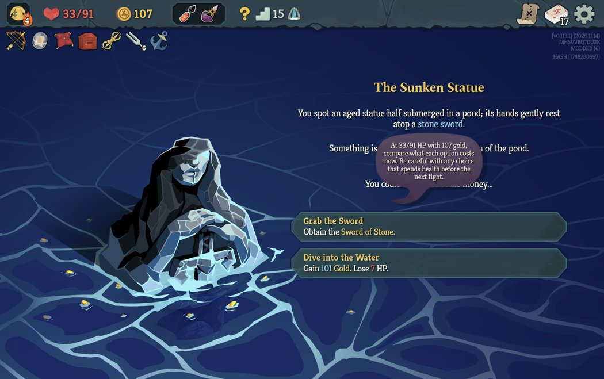
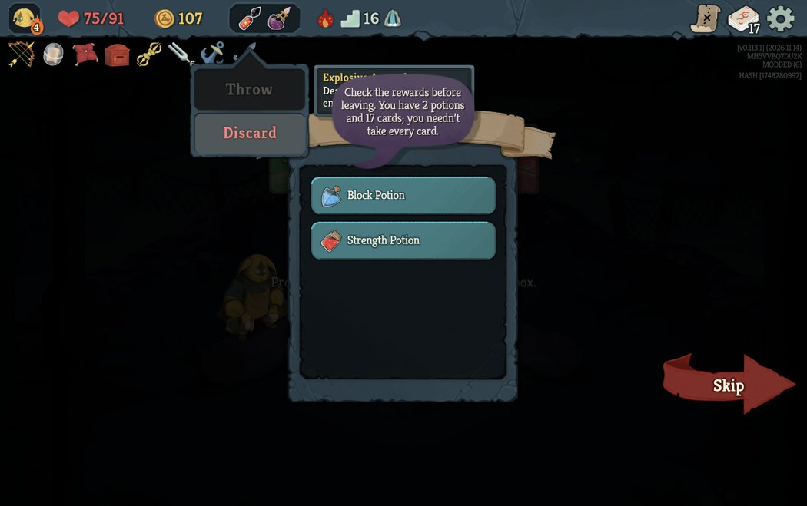

# Vakuu’s Agentic Auditor

Ever hover over three cards and wish someone would make a case for **Skip**? Vakuu looks at the deck you actually have and offers a second opinion. In a fight, ask for a sequence from your current hand. At a fork, see what the next few rooms offer. You always make the play.

**[Download the mod](https://github.com/cdimartino/VakuusAgenticAuditor/releases/latest/download/VakuusAgenticAuditor.zip)** · [Release notes](https://github.com/cdimartino/VakuusAgenticAuditor/releases) · [Report a confusing suggestion](https://github.com/cdimartino/VakuusAgenticAuditor/issues/new)

For **solo runs on Slay the Spire 2 public-beta v0.113.1**. Works offline, from the first floor. No relic, API key, BaseLib or other mod required.

## Install and meet Vakuu

1. Quit the game. Download **VakuusAgenticAuditor.zip** above and extract the whole ZIP.
2. **Mac:** double-click **Install.command**. **Windows:** right-click **Install.ps1** and choose **Run with PowerShell**. **Linux:** run `sh Install.command` in the extracted directory.
3. Start STS2, enable **Vakuu’s Agentic Auditor** in **Mods**, and restart if prompted. In a solo run, press **V** when there’s a decision to make.

**Custom Steam library, or prefer not to run an installer?** In Steam, right-click the game → **Manage → Browse local files**. Copy the extracted **VakuusAgenticAuditor** folder into `mods` alongside the game executable. On macOS, right-click `SlayTheSpire2.app` → **Show Package Contents → Contents → MacOS → mods**. Create `mods` if needed. The finished path should end in `mods/VakuusAgenticAuditor/VakuusAgenticAuditor.dll`.

## Make the coach yours

| When you want to… | Do this |
|---|---|
| Ask for advice, or dismiss it | Press **V**, click the bubble to dismiss, or use controller **Back + right shoulder** |
| Move it out of the way | **Drag the speech bubble** with the left mouse button. Map, fight, event, shop, campfire and choice screens remember their own spots across runs. Reward bubbles still avoid the reward controls. |
| Get advice only when you ask | **Settings → General → Vakuu’s Agentic Auditor… → Guidance: On demand** |
| Adjust the coach | Open those settings, press **F8**, or use **Back + left shoulder**. Change shortcuts, praise, criticism, combat frequency and more. **Reset bubble positions** restores automatic placement. |
| Quiet everything for a while | Press **F6** to mute; press it again to unmute |

On some Mac keyboards, hold **Fn** for F6 or F8. Changes save immediately.

### At an event

Vakuu weighs the cost against your current health. The same trade that makes sense at full HP can be a poor one before a boss. The screenshots here are from an earlier beta playtest; the wording and default placement have since changed.

### Before the next fight

For example, if your belt is full before Waterfall Giant, Vakuu can recommend replacing an Explosive Ampoule with Block Potion and saving it for Explode. In combat, potion suggestions take your hand and incoming damage into account.

## If something feels off

- **I don’t see the mod in Steam.** The ZIP is a local installation. Look in the **game’s Mods list**, not Steam’s Subscribed Items. A Workshop listing has not been published.
- **Nothing appeared.** Try **V** at a card reward. Check mute, the advice category, and Guidance under Settings. On demand waits for you; **Only show clear leads** filters close automatic picks.
- **That recommendation looks wrong.** This is a heuristic coach, not a perfect solver. A screenshot of the hand/options, enemy intents, and the game and mod versions makes an excellent [issue](https://github.com/cdimartino/VakuusAgenticAuditor/issues/new). The [coverage audit](audit/README.md) lists the limits.
- **How do I update or remove it?** Quit STS2 and run the new installer, or replace the same mod folder. To uninstall, remove only `mods/VakuusAgenticAuditor`. Player preferences stay under `user://mod_configs/VakuusAgenticAuditor/`.

[Building, tests and release workflow](CONTRIBUTING.md) · [Steam Workshop publishing guide](workshop/README.md)

Unofficial fan mod. Slay the Spire 2, its characters and game artwork belong to Mega Crit. Wiki metadata attribution is in the [audit](audit/README.md).
