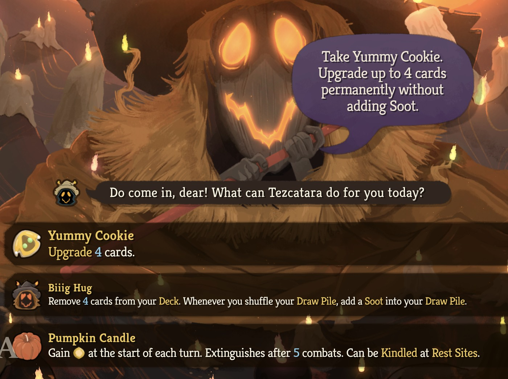
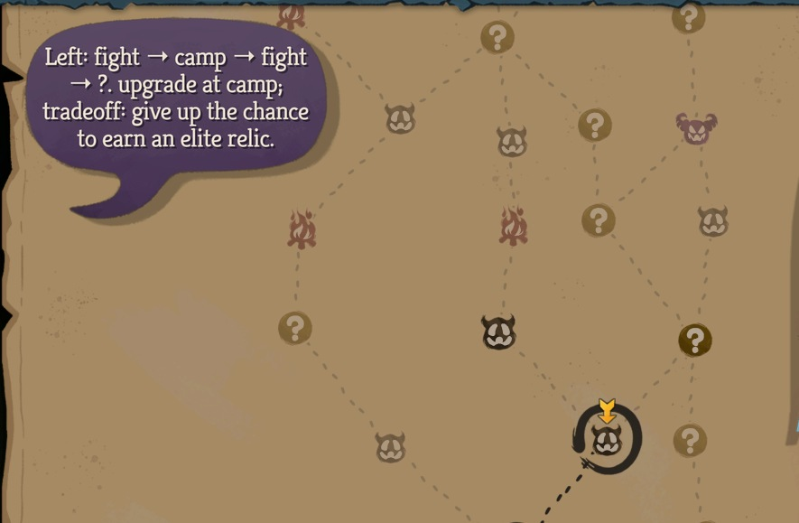

# Vakuu’s Agentic Auditor

Ever hover over three cards and wish someone would make a case for **Skip**? Vakuu looks at the deck you actually have and offers a second opinion. In a fight, ask for a sequence from your current hand. At a fork, see what the next few rooms offer. You always make the play.

**[Download the mod](https://github.com/cdimartino/VakuusAgenticAuditor/releases/latest/download/VakuusAgenticAuditor.zip)** · [Release notes](https://github.com/cdimartino/VakuusAgenticAuditor/releases) · [Report a confusing suggestion](https://github.com/cdimartino/VakuusAgenticAuditor/issues/new)

For **solo runs on Slay the Spire 2 public-beta v0.113.1**. Works offline, from the first floor. No relic, API key, BaseLib or other mod required.

**Game updates:** Vakuu selects coaching data for the exact game release. The audited snapshot is public-beta v0.113.1 (Steam build `26660232`). On an unrecognized build the coach stays inactive by default. To try approximate advice, open **Settings → General → Vakuu’s Agentic Auditor → Unknown patch: use closest catalog**, then restart the game. The menu shows the active catalog. Exact matches always win; otherwise Vakuu picks the nearest audited numeric version within the same major version (older patch on a tie). Card effects may differ. Turn the option off and restart to restore strict matching. Both main and public-beta are [monitored for changes](https://github.com/cdimartino/VakuusAgenticAuditor/actions/workflows/watch-game.yml); monitoring a branch does not mean its latest build has passed review.

*Four upgrades now, or four removals with Soot on every shuffle? Here the deck has enough useful upgrade targets for Vakuu to recommend the Cookie.*

## Install and meet Vakuu

1. Quit the game. Download **VakuusAgenticAuditor.zip** above and extract the whole ZIP.
2. **Mac:** double-click **Install.command**. **Windows:** right-click **Install.ps1** and choose **Run with PowerShell**. **Linux:** run `sh Install.command` in the extracted directory.
3. Start STS2, enable **Vakuu’s Agentic Auditor** in **Mods**, and restart if prompted. In a solo run, press **V** when there’s a decision to make.

**Custom Steam library, or prefer not to run an installer?** In Steam, right-click the game → **Manage → Browse local files**. Copy the extracted **VakuusAgenticAuditor** folder into `mods` alongside the game executable. On macOS, right-click `SlayTheSpire2.app` → **Show Package Contents → Contents → MacOS → mods**. Create `mods` if needed. The finished path should end in `mods/VakuusAgenticAuditor/VakuusAgenticAuditor.dll`.

## Make the coach yours

**Optional challenge: Curse Mode.** Press **F8** and turn on the first toggle to make Vakuu an unreliable coach. It starts **off**. At Ascension 0, each advice decision has a **10%** curse chance; add **3 percentage points per level**, up to **40% at A10**. A cursed card reward points to a weaker available choice; from **A5** it points to the weakest. If there’s no clearly weaker reward, or you’re asking about another kind of decision, Vakuu withholds the hint instead.

Watch for **CURSE · Crooked counsel** or **CURSE · Hint withheld**, followed by Vakuu’s remark. Asking again won’t reroll the curse. Post-pick feedback and run reviews stay honest. The curse affects advice only; it doesn’t add cards to your deck.

| When you want to… | Do this |
|---|---|
| Ask for advice, or dismiss it | Press **V**, click the bubble to dismiss, or use controller **Back + right shoulder** |
| Move it out of the way | **Drag the speech bubble** with the left mouse button. Map, fight, event, shop, campfire and choice screens remember their own spots across runs. Reward bubbles still avoid the reward controls. |
| Get advice only when you ask | **Settings → General → Vakuu’s Agentic Auditor… → Guidance: On demand** |
| Adjust the coach | Open those settings, press **F8**, or use **Back + left shoulder**. Change shortcuts, praise, criticism, combat frequency and more. **Reset bubble positions** restores automatic placement. |
| Quiet everything for a while | Press **F6** to mute; press it again to unmute |

On some Mac keyboards, hold **Fn** for F6 or F8. Changes save immediately.

### Which way at the fork?

*The first fight on the left leads to a campfire upgrade. The right branch keeps an elite relic in reach. Vakuu looks ahead so you can decide whether the trade is worth it.*

The v0.1.22 candidate scores the entire reachable act from the first map. The result is a preference for your current resources, not a prediction of hidden encounters. Turn on **Route overlay** (beside **Map** in Auditor settings) for a moving dashed trace; it is off by default.

On the audited beta, combat advice can distinguish a known fixed follow-up from a conditional or random move. Exoskeleton’s observed Hard to Kill amount is applied separately to each hit. Unknown powers and effects are not assumed to be fully simulated.

These two documentation examples are staged from gameplay captures with the game's native speech bubble and the v0.1.16 coach's output.

Vakuu’s bubble grows with the wrapped text at your selected text size. If a detailed comparison is longer than the available space, scroll inside the bubble with the mouse wheel or trackpad. A scrollable hint stays open until you dismiss it or the decision changes.

## Find a direction, then learn from the run

At card rewards Vakuu can spot more than one way forward. If your Silent already has Blade Dance, Accuracy is a **Shiv engine** opportunity; owning a payoff alone doesn’t mean the engine is online. The coach looks for supported lines across all six characters without locking your deck into a single build.

After a solo victory or defeat, **Vakuu’s run review** summarizes your deck identity, progress by act, largest recorded HP loss, upgrades, removals, gold spent and potion use. A loss review separates the recorded killer from coaching hypotheses and suggests what to practice next. Reopen it from the results screen or **Auditor settings → Read latest run review**. Disable **Open review after a run** to keep it on demand. The latest review stays locally in `user://mod_configs/VakuusAgenticAuditor/latest-run.txt`.

### A record of what actually happened

Local recording is on by default. During a supported solo run, Vakuu samples changing game state up to ten times per second: hand and deck, HP/block/resources, enemies and visible powers/intents, current choices, delivered advice (including curses), and completed card plays reported by the game. It also records state transitions; those are not proof of which action caused an effect. Recording continues while advice is muted.

The end review includes a per-floor history and bounded highlights from this evidence. It does not claim an unused potion would have saved you or compare a prediction against unrelated HP loss. Turn recording cannot reconstruct earlier, unrecorded play.

Files stay on your computer under `user://mod_configs/VakuusAgenticAuditor/runs/` as JSONL. No API key or network service is needed. Vakuu keeps at most 12 journals, with a 32 MiB limit per journal; reaching that limit stops recording for that run. Toggle **Record game-state snapshots locally** in Auditor settings to disable it. Recording gaps and storage failures limit the assessment rather than interrupting gameplay. Close the game before deleting journals you no longer want.

**For playtest agents:** the separate, default-off **Export playtest setup** option exposes fresh advice to a [guarded local runner](docs/PLAYTESTING.md). It refreshes advice after changed combat state for that opt-in test; ordinary once-per-turn guidance is unchanged. The exporter does not play the game itself. The runner requires an explicitly approved profile/run and permission to send game actions.

## Troubleshooting

- **I don’t see the mod in Steam.** The ZIP is a local installation. Look in the **game’s Mods list**, not Steam’s Subscribed Items. A Workshop listing has not been published.
- **Nothing appeared.** Try **V** at a card reward. Check mute, the advice category, and Guidance under Settings. On demand waits for you; **Only show clear leads** filters close automatic picks.
- **That recommendation looks wrong.** This is a heuristic coach, not a perfect solver. A screenshot of the hand/options, enemy intents, and the game and mod versions makes an excellent [issue](https://github.com/cdimartino/VakuusAgenticAuditor/issues/new). The [coverage audit](audit/README.md) lists the limits.
- **How do I update or remove it?** Quit STS2 and run the new installer, or replace the same mod folder. To uninstall, remove only `mods/VakuusAgenticAuditor`. Player preferences stay under `user://mod_configs/VakuusAgenticAuditor/`.

[Building, tests and release workflow](CONTRIBUTING.md) · [Steam Workshop publishing guide](workshop/README.md)

Unofficial fan mod. Slay the Spire 2, its characters and game artwork belong to Mega Crit. Wiki metadata attribution is in the [audit](audit/README.md).
